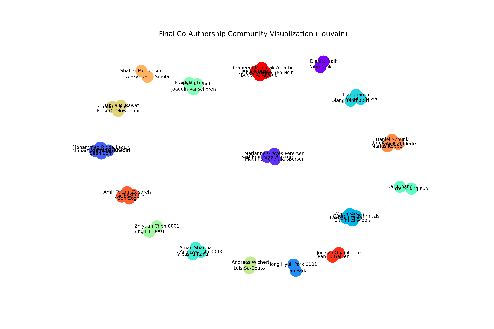
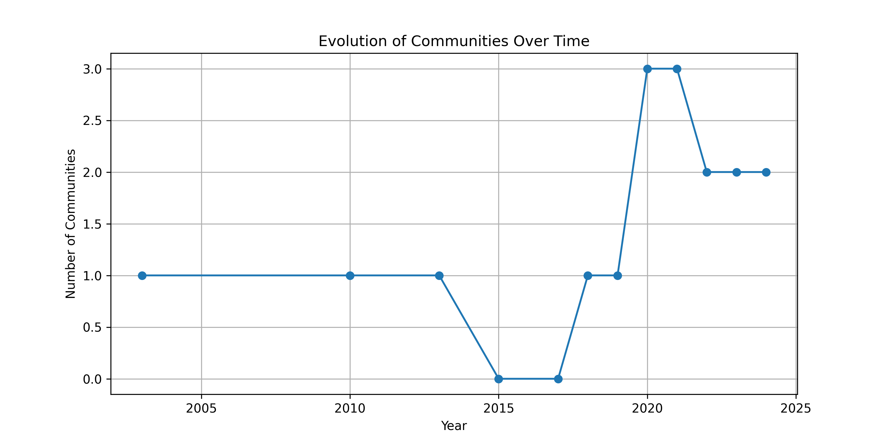
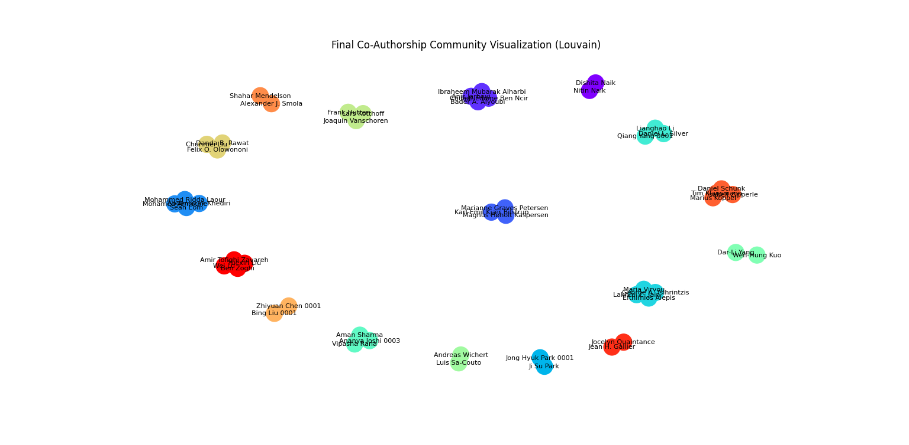

# DBLP Co-authorship Network Analysis

Temporal analysis of researcher collaboration networks using DBLP publication data, graph analysis, Louvain community detection, and modularity.

## Project Overview

This project analyzes collaboration patterns between researchers by constructing yearly co-authorship networks from DBLP publication data.

Each researcher is represented as a node, and an edge is created between researchers who co-authored the same publication.

The project studies how the structure of the research network changes over time, including collaboration links, detected communities, and modularity.

## Objectives

- Construct yearly co-authorship networks from DBLP publication data.
- Analyze researchers and collaboration links.
- Detect research communities using the Louvain algorithm.
- Calculate modularity to evaluate community structure.
- Analyze changes in the network over time.
- Generate network and temporal evolution visualizations.

## Methodology

The project follows these main steps:

1. Retrieve publication data from the DBLP search API.
2. Extract publication years and author information.
3. Construct co-authorship graphs for each year.
4. Apply Louvain community detection.
5. Calculate network modularity.
6. Analyze changes in researchers, collaboration links, communities, and modularity.
7. Generate network and temporal evolution visualizations.

## Community Detection

The project uses the Louvain community detection algorithm to identify groups of researchers with stronger collaboration patterns.

Modularity is calculated to quantitatively evaluate the quality of the detected community structure.

## Visualizations

### Co-authorship Community Graph



### Evolution of Communities Over Time



### Community Structure Evolution



## Technologies

- Python
- NetworkX
- Pandas
- Matplotlib
- DBLP XML API

## Project Structure

```text
dblp-coauthorship-network/
│
├── crawler.py
├── build_graph.py
├── community_detection.py
├── improved_community_detection.py
├── visualization.py
├── final_visualization.py
├── yearly_analysis.py
├── year_plot.py
├── final_assignment_pipeline.py
│
├── community_graph.png
├── evolution_trend.png
├── community_structure_evolution.png
│
└── README.md
```

## Academic Context

This project was developed as an academic graph analysis project focused on temporal co-authorship networks and community detection.

## Author

Hsina Arije
